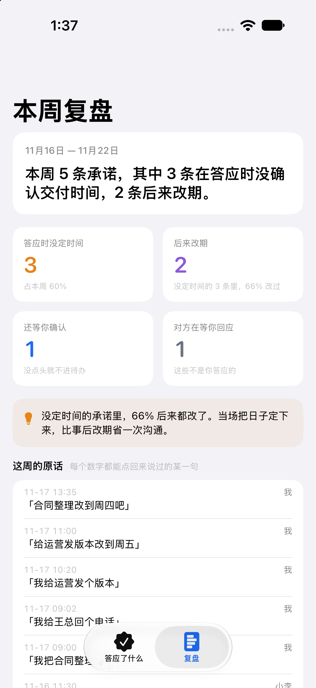

# Athos · 从「听到的话」到「我答应了什么」

两个端，一条链：

| 端 | 职责 | 不做什么 |
|---|---|---|
| Apple Watch | 只在有人说话时写盘，把一天切成可回听的片段；**判断「谁答应了什么」也在手表上** | 不做语音识别（watchOS 根本没有 Speech 框架，这是系统边界不是取舍） |
| iPhone | 把片段转成文字并送回手表；展示手表算出的结论，等你确认，写进提醒事项，每周复盘 | 不做承诺判断（判断的真相在手表，手机是镜像） |

手表端解决的是**采集成本**：静音不写盘，一小时 8–9 MB，戴一天不用管；同时它也是判断中枢，因为原话和录音本来就在它这儿。
手机端解决的是**识别成本**：只有 iPhone 能跑语音识别，所以它是「识字的人」——读完把字念回给手表，结论由手表下。

---

## 当前状态（请先读这段）

| 项目 | 状态 |
|---|---|
| 静音门控算法（dBFS、自适应噪声底、迟滞、驻留、过零率过滤） | **已实现，并已在本机用合成信号验证通过** |
| 功耗模型（占空比 → 每小时耗电 → 可用时长） | **已实现，可运行** |
| watchOS 采集、分段写盘、中断处理 | **已编译并运行**（Xcode 27.2 / watchOS 27.2 模拟器） |
| 门控 → 切段 → AAC 写盘 全链路 | **已在模拟器用合成信号端到端验证**，产出可解码的 m4a |
| SwiftUI 界面 | **已编译并运行**，46mm 屏无溢出；一个圆球 + 状态 + 已录总时长 |
| 录音列表与就地试听 | **已实现**，手表上可看时长/大小并播放、左滑删除 |
| 时长格式化 | **已实现并有单元断言**（`make gate` 里 13 组边界用例） |
| 电脑端导出脚本 | **已提供**（`tools/pull-recordings.sh`），未接真机验证 |
| 手机端：承诺账本首页 | **已实现并运行**（iPhone 18 Pro / iOS 27.2 模拟器） |
| 手机端：确认后写入 Apple 提醒事项 | **已实现并已验证**（授权 → 写入 → 读回 1 条，见「验证记录」） |
| 承诺合并（改期不新建、征询等确认、对方请求不入账） | **已实现，38 项命令行断言全过**（`make promises`） |
| 中文时间解析（周、明日、月底、时刻、无时间） | **已实现并断言**，覆盖 16 种说法 |
| 手机端：周复盘 | **已实现并运行**，指标全部来自原话 |
| 转写（语音转文字） | **已接入手机端 `SFSpeechRecognizer`**，用真实中文音频成功识别过 6 段；模拟器的系统识别服务后来进入持续报错状态，**真机未验**（见「验证记录」） |
| 手表 ↔ 手机 蓝牙链路（WCSession） | **已实现并端到端跑通**：真实音频从手表送到手机，文本回传，手表生成承诺，快照回到手机首页 |
| 说话人分离（谁在说） | **未实现**，目前一段音频整体按「我」处理 |
| iCloud 同步、Live Activity | **未实现**，见「下一步」 |

端到端验证的实测结果（`-synthetic` 启动，12 秒合成信号：2s 静音 → 3s 人声 → 4s 静音 → 3s 人声）：

```
gate opened → gate closed → gate opened
seg-…-184315-834.m4a   6.22s   15655 B   （1.5s 预录 + 4.72s 人声）
seg-…-184325-329.m4a   4.22s    6990 B   （1.5s 预录 + 2.72s 人声）
解码回 PCM：peak -21.7 dBFS，与合成信号幅度一致
```

即：文件能生成、能解码、内容对得上，不是「有文件但播不出来」。

---

## 快速开始

需要 **Xcode 16 或更新版本**。想看界面用模拟器就够（`make sim`）；想验证真实拾音和功耗必须真机——模拟器没有麦克风输入。

最省事的一条命令：

```bash
cd AthosWatch
make sim      # 生成工程 → 构建 → 装进模拟器 → 启动 → 截图
```

想知道每个 make 目标干什么：`make help`。想手工操作继续看下面。

### 方式一：XcodeGen（推荐）

```bash
brew install xcodegen
cd AthosWatch
xcodegen generate
open AthosWatch.xcodeproj
```

### 方式二：手动建工程

1. Xcode → New Project → **App** → Platform 选 **Apple Watch** → Interface **SwiftUI** → Language **Swift**。
2. 删掉自动生成的 `ContentView.swift` 和 `<Name>App.swift`。
3. 把本目录 `Sources/` 下所有 `.swift` 拖进工程（勾选 Copy items if needed，Target 选 Watch App）。
4. 用本目录 `Support/Info.plist` 覆盖工程自带的 Info.plist，或在 Target → Info 中手动加入：
   - `NSMicrophoneUsageDescription`
   - `UIBackgroundModes` → `audio`
5. Signing & Capabilities 里选好 Team，Bundle Identifier 改成你自己的。

### 运行

表上打开 Athos，点中央那个圆球开始监听，授权麦克风，然后正常说话即可。

整个界面只有一个可操作的控件，状态全靠颜色表达：

| 样子 | 含义 |
|---|---|
| 灰色圆球、点状细环、字是「待机」 | 没在录 |
| 青色圆球、环上短棒缓慢起伏、字是「在听」 | 麦克风在工作，但没人在说话，**不写盘** |
| 绿色圆球、短棒随音量跳动、字是「记录中」 | 判定有人声，**正在写盘** |

球下面那行数字是**已录总时长**，格式 `分:秒`，满一小时变 `时:分:秒`。它的口径和「录音」列表头那行完全一样——盘上所有分段之和，加上正在录、还没落盘的那一段。所以录的时候它会一秒一秒往上走，停止后停住，重开 App 也还是那个数。

颜色跟着状态走：记录中是绿色（在涨），在听是青色（不动），待机是灰色（更暗）。

录音时中心按钮外那圈细弧会一点点走满（每 120 秒走一圈，走满就换下一个文件），这是本段的进度，和下面那行总时长是两个不同的量。

停止后音频在 App 沙盒 `Documents/Segments/` 下，每段一个 `.m4a` 加一个同名 `.json` 元数据。

---

## 蓝牙：录音怎么从手表到手机

```bash
make link            # 合成 6 段中文语音 → 手表 → 手机转写 → 手表判断 → 截图日志
make link -- --fake  # 没有可用识别服务时，用已知台词验证后半段（engine=injected）
```

### 前提：手表 App 必须是伴随 App

以前手表端是 `WKWatchOnly` 的独立 App，没有配对对象，`WCSession` 永远激活不了。改成伴随 App 是关键一步：

```yaml
# project.yml
AthosPhone:
  dependencies:
    - target: AthosWatch      # xcodegen 会自动生成 "Embed Watch Content" 阶段
AthosWatch:
  info:
    properties:
      WKCompanionAppBundleIdentifier: com.kakaqiang.athos.phone
```

产物落在 `Athos.app/Watch/Athos.app`，bundle id 必须以宿主 App 为前缀（`com.kakaqiang.athos.phone.watchkitapp`），否则安装时被系统拒绝。

### 三条通道，各管一段

| 传什么 | 用什么 | 为什么 |
|---|---|---|
| 音频（≤56 KB） | `sendMessage` + 回执 | 一句话的音频只有十几 KB，即时送到，回执能确认「真的收下了」 |
| 音频（>56 KB） | `transferFile` | 120 秒长段可能几百 KB，只有文件通道搬得动；排队、断点友好 |
| 转写文本 | `sendMessage` + 回执，失败退 `transferUserInfo` | 小、要快；手表在后台时退回排队通道保证送达 |
| 账本快照 | `updateApplicationContext` | 只保留最新一份，旧的自然覆盖——账本要的就是这个语义 |
| 确认/放弃/完成 | `transferUserInfo` | 手表多半不在前台，动作必须最终送达 |

### 为什么判断留在手表

转写只能在 iPhone 上做（watchOS 没有 `Speech.framework`），但**判断不需要跟着走**：`Shared/Domain` 是纯 Foundation，两端都能跑。让手机只回传「这段说了哪些字」，手表自己判「谁答应了、答应到什么程度、后来有没有变」，有三个好处：

1. 原话和录音本来就在手表上，判断不用把历史倒来倒去；
2. 手机不在身边时，抬腕就能看到刚答应的那条；
3. 判断逻辑只有一份，不会被两端各改一版改歪。

手机端首页是这份快照的镜像，不自己合并——合并需要一套「谁更新」的规则，而那套规则本身就是判断。

### 两个会静默丢数据的坑

**坑一：`transferFile` 在手表模拟器上不投递。** 调用返回正常，手表端日志也正常，手机端连 `handleIncomingFile` 都不出现。所以小段改走字典通道，模拟器上才验证得动，真机两条路径都在。

**坑二：`transferUserInfo` 的 `didFinish` 在模拟器上会立刻回调「成功」，但对端根本没收到。** 如果拿它当送达依据，录音会被标记成「已发送」永远不重试。现在只有 `sendMessage` 的**回执**才算送达；失败会从已发送集合里摘掉，下次补发。

---

## 手机端：我答应了什么

```bash
make phone     # 构建 + 装进 iPhone 模拟器 + 截图
make review    # 同上，直接打开复盘页
```

### 首页为什么分三段

| 分组 | 进去的条件 | 为什么单独放 |
|---|---|---|
| 待你确认 | 你说的是「要不…」「应该可以」，或对方提了请求而你还没接 | 没点头之前不进待办。否则「我答应了什么」立刻变成一堆我没答应的事 |
| 接下来 | 你确认过、还没结束 | 按截止时间排，不按创建时间。会先到期的东西先出现 |
| 已经结束 | 完成 / 放弃 | 放最后，只用来回看 |

顶部那三个数字不是装饰，它们是周评盘的同一个口径：本周承诺数、其中答应时没定时间的、以及这些里后来改期的。

### 一条承诺长什么样

点开任意一条，看到的不是摘要，是它自己的历史：

```
把报价发给小李                      [改期 1]
周五前 · 给小李                     ●● 2 句原话

  ● 11-16 09:12  我  「我周五前把报价发给小李」   ▶
  │
  ● 11-16 09:14  我  「改到下周一吧」             ▶

  日期从 11月20日 改成 11月23日，仍是同一条。
```

两句原话都在，各自带播放按钮。回听时听到的不只是内容，是当时改口的语气。

### 确认之后才写提醒事项

「确认」做两件事：把状态改成进行中，然后调 `EKEventStore` 写一条提醒。写入用 iOS 17 的 `requestFullAccessToReminders()`；写失败只影响那条徽标，不会把用户的确认动作一起回滚。

手表端做不了这件事——watchOS SDK 里 `saveReminder` / `saveEvent` / `saveCalendar` / `commit` 全部标了 `__WATCHOS_PROHIBITED`。这是手机端存在的第一个硬理由，不是设计偏好。

### 周复盘只说能数清的话



结论句是拼出来的，不是写死的模板：「本周 5 条承诺，其中 3 条在答应时没确认交付时间，2 条后来改期。」每个数字都能点回原话——页面底部永远挂着「这周的原话」，因为一个数字只有在能指回某句话时才有说服力。

指标口径见下面「承诺是怎么判断的」。

---

## 承诺是怎么判断的

这部分比录音重要。三个问题必须分开回答，混在一起就会做成一堆假待办。

### 1. 谁答应的

`promisor` 是承诺人，不是说话人之外可有可无的字段。对方说「你有空帮我看一下吗？」，这是**请求**，不是我的承诺，它只进「等你回应」，不进待办，也不写提醒事项。

### 2. 答应到什么程度

| 强度 | 长什么样 | 落库状态 |
|---|---|---|
| `offer` 提议 | 「要不周五发？」「我可以帮你」 | 待确认，不进提醒事项 |
| `tentative` 有保留 | 「应该可以」「尽量」「看情况」 | 待确认 |
| `firm` 明确 | 「我周五前发」「就这么定」 | 进行中 |

判断依据是情态词表，不是模型打分——错了能一眼看出是哪个词判断错，加一条用例就修好。

### 3. 后来有没有变

一条承诺是一串修订，不是一个字段：

```
created(截止=周五, 强度=firm)  →  dueChanged(周五 → 下周一)
```

每次修订都挂着一个 `utteranceID`。所以「同一条待办的日期被更新，两句原话都能回听」是结构保证的，不是界面拼出来的效果。

### 合并的四条规则

按顺序生效，每条对应一句真实口语：

| 听到什么 | 条件 | 结果 |
|---|---|---|
| 「好」「就这么定」 | 只有确认词 | 把最近那条待确认转正 |
| 「改到下周一吧」 | 有改期动词 + 能解析出时间 | 更新**同一条**的截止时间，不新建。对不上任何一条才新建 |
| 「你有空帮我看一下吗？」 | 说话人是对方 + 是问句 | 记成对方提的，进「等你回应」 |
| 「要不周五发？」 | 问句或提议语气 | 新建一条待确认，绝不直接变待办 |

另外还有两条兜底：同一件事同一个时间重复说 → 忽略；完全没听出可执行内容 → 忽略并记录原因。

### 时间解析的边界

`ChineseDueParser` 宁可解析不出，也不瞎猜。解析失败返回 `nil`，上层把这件承诺标成「没定时间」——这恰恰是复盘要看的东西，不是数据缺陷。反过来，猜错一个日期会污染整条承诺链，代价高得多。

当前覆盖：今天/明天/后天、周X、这周X、下周X、下下周X、M月D日、N号、月底/月末/月初、时刻（上午下午晚上凌晨 + 点半/分）。不含：农历、季度、「这个月之内你看着办」这类模糊表达。

只给日期不给时刻时，一律按当日 23:59 存，界面念作「周五前」——不把 23:59 这个实现细节泄漏给用户。

### 「答应时没确认交付时间」到底怎么算

看**第一次 `created` 修订里的 due**，不是当前 due。当前 due 可能已经被改过三次，用它统计会把「一开始就没定」和「定了又改」混成一件事。

写进 `Commitment.originDue`，附一条断言锁住这个口径。

---
## 设备要求

**Athos 是纯手表 App（`WKWatchOnly = true`），没有 iOS 端，装不到 iPhone 上。** iPhone 只在安装时当中转站。

| 角色 | 要求 | 说明 |
|---|---|---|
| Apple Watch | **watchOS 10 或更新** | Series 4 及以后都能装（工程最低部署目标 10.0） |
| iPhone | 必须能**配对**那块手表 | 见下面这条坑，这是最容易卡住的地方 |
| Mac | macOS 26+ | Xcode 27 的系统要求 |

### 旧 iPhone 的坑（含 iPhone XS / XR）

iPhone XS、XS Max、XR 的最后一个系统是 **iOS 18.7.x**，苹果已停止支持，升不到 iOS 26。而 **watchOS 26 起要求 iPhone 11 或更新 + iOS 26** 才能配对。所以：

- 手表停在 **watchOS 10 / 11** → iPhone XS 能配对，Athos 能装能用（工程支持 watchOS 10+）
- 手表已经是 **watchOS 26 / 27** → iPhone XS **配不上那块表**，装不了 App；这不是 Athos 的限制，是系统要求

自查：手表 → 设置 → 通用 → 关于 → 看「版本」。高于 11 就是升不上去了，得换 iPhone 11 及以后的机型。

> 不要为了装 App 去升级手表系统。watchOS 一旦升到 26，就再也回不到能和旧 iPhone 配对的版本（Apple 不允许手表系统降级）。

## 安装到真机（Apple Watch）

先跑一次体检，它会告诉你现在缺什么，不用一条条对照：

```bash
make doctor
```

```
[1] Xcode            ✓ Xcode 27.2
[2] watchOS SDK      ✓ watchOS 27.2      ✓ 模拟器运行时
[3] 工程与工具链      ✓ xcodegen        ✓ Sources 下所有 .swift 都已在工程里
[4] 签名             ✓ 1 个可用的开发证书  ✓ Team ID: UAXGUNTFU8
                     ! 这是免费 Personal Team：证书 7 天过期
[5] 设备             ! 没有已连接的 Apple Watch   ✓ 模拟器已启动
结论：签名就绪，但没检测到手表。可以先 make sim 看界面。
```

结论只有三种，对应的下一步很明确：

| 结论 | 下一步 |
|---|---|
| 可以装到真机 | `⌘R`，或 `./redeploy.sh <手表UDID>` |
| 签名就绪但没检测到手表 | 接上手表重跑体检，或先 `make sim` |
| 只能跑模拟器 | 按下面第 1~3 步补签名 |

### 0. 装 Xcode

只能从 App Store 装（约 15 GB 下载，装完占 40 GB 以上）。装完必须把命令行工具指向它，否则 `xcodebuild` 依然报 “requires Xcode”：

```bash
sudo xcode-select -s /Applications/Xcode.app/Contents/Developer
sudo xcodebuild -runFirstLaunch
xcodebuild -version    # 能打印版本号才算成功
```

### 1. 让 Xcode 认识你的 Apple ID

Xcode → **Settings → Accounts** → `+` → Apple ID → 登录（需要双重认证）。登录后账号会显示为 **Personal Team**——这就是免费签名能力。

免费账号的限制（官方口径，必须知道）：

| 项目 | 免费账号 |
|---|---|
| 证书有效期 | **7 天**，到期 App 打不开，需重新构建安装 |
| 可注册 App ID | 10 个 |
| 可注册设备 | 3 台 |
| 每台设备可装 App | 3 个 |
| TestFlight / 上架 | 不支持，需 $99/年 |

要长期戴着测功耗，建议先忍耐重装两次再决定是否付费。

### 2. 两台设备都开「开发者模式」

缺这一步会卡在 “Unable to install”。

- **iPhone**：设置 → 隐私与安全性 → 开发者模式 → 打开 → 重启 → 上滑点「启用」→ 输密码
- **Apple Watch**：设置 → 隐私与安全性 → 滚动到底 → 开发者模式 → 打开 → 重启 → 点「开启」→ 再点「信任」→ 输手表密码

手表的开发者模式**只能在手表上开**，iPhone 的 Watch App 里没有这个开关。

### 3. 配签名

```bash
cd AthosWatch
brew install xcodegen
xcodegen generate
open AthosWatch.xcodeproj
```

在 Xcode 里选中工程 → Target `AthosWatch` → **Signing & Capabilities**：

- 勾选 **Automatically manage signing**
- Team 选你的 **Personal Team**
- Bundle Identifier 改成全局唯一，例如 `com.你的名字.athos`（必须改，`com.athos.watch` 已经被占用时会报 “bundle identifier is not available”）

### 4. 部署

1. 用数据线接 iPhone，手表戴在手上并**解锁**，最好**放在充电器上**，两台设备连同一个 Wi-Fi。
2. Xcode 顶部 scheme 选 `AthosWatch`，运行目标下拉里选你的 **Apple Watch**（不是模拟器）。
3. 按 **⌘R**。首次会显示 “Preparing watch for development…”，**等几分钟不要中断**，期间两台设备都要保持解锁。
4. 首次启动若提示「未受信任的开发者」：手表上 设置 → 通用 → VPN 与设备管理 → 点你的 Apple ID → 信任。

### 5. 每周重装

7 天后 App 图标点不开。两种方式：

- Xcode 里重新 **⌘R**
- 或跑脚本（先 `chmod +x redeploy.sh`）：

```bash
xcrun devicectl list devices        # 找到手表的 UDID
./redeploy.sh <手表UDID>
```

> ⚠️ 重装前先把 `Documents/Segments/` 里的录音导出——重签重装有可能清空 App 沙盒。

签名与 Bundle ID 已经写好在 `project.yml` 里（Team `UAXGUNTFU8`、`com.kakaqiang.athos`），换电脑或换账号时改这两行即可，不必在 Xcode 图形界面里再改一遍——**图形界面里改的签名会被下一次 `xcodegen generate` 冲掉**。

### 装不上时的排查顺序

| 现象 | 原因 | 处理 |
|---|---|---|
| `xcodebuild: requires Xcode` | 命令行工具仍指向 CLT | 执行第 0 步的 `xcode-select` |
| 运行目标列表里没有手表 | 表未解锁 / 不在充电 / 未连同一 Wi-Fi | 解锁、放充电器、等 “Preparing…” 结束 |
| `Unable to install` | 开发者模式没开 | 两台设备都按第 2 步重做一遍 |
| `bundle identifier is not available` | Bundle ID 与别人重复 | 改成含你名字的唯一 ID |
| `Untrusted Developer` | 证书未信任 | 手表上 VPN 与设备管理里信任 |
| 编译报错（AVAudioFile / SwiftUI 相关） | 首次编译的 API 差异 | 把报错贴出来，逐条改 |
| `0 valid identities found` 但证书确实存在 | 缺 WWDR **G3** 中间证书，证书链断裂 | 见下方说明 |

#### 证书存在却被判为「无效身份」

症状：`security find-identity -p codesigning` 能列出证书，但 `-v`（仅有效）返回 0，`security verify-cert` 报 `CSSMERR_TP_NOT_TRUSTED`。

原因：Xcode 27 签发的开发证书由 **Apple Worldwide Developer Relations **G3**** 中间证书签发，而 macOS 系统钥匙串里通常只有更老的 G1，链在此断开。

修复（不需要联网，Xcode 自带这份证书）：

```bash
G3="/Applications/Xcode.app/Contents/SharedFrameworks/DVTFoundation.framework/Versions/A/Resources/AppleWWDRCA-2030.cer"
security import "$G3" -k ~/Library/Keychains/login.keychain-db
security find-identity -v -p codesigning    # 应出现 1 valid identities found
```

> 注意：`AppleWWDRCAG6.cer` 是 G6，`AppleWWDRCA-2030.cer` 才是 G3。两者同名不同版，别导错。

#### 查 Team ID

如果脚本自动识别失败，可以在 Xcode 偏好里直接读：

```bash
defaults read com.apple.dt.Xcode IDEProvisioningTeamByIdentifier
```

输出里的 `teamID` 就是需要的 10 位值。

---

## 怎么录（日常操作）

手表上打开 Athos，点**中央那个圆球**开始监听，除此之外没有别的开关。系统不允许任何 App 自行开始采集，这一步只能手动（后续可用快捷指令自动化绕开）。

屏幕上的三种状态（灰=待机、青=在听、绿=记录中）见上面「运行」一节的表。其中「在听」是最常态：麦克风在工作，但没人说话，一个字节都不写。

- 说话后 **0.3 秒**开始写，静音后 **2 秒**收尾；句子之间的短暂停顿不会把一段话切碎
- 息屏、切到表盘、放下手腕都可以继续录（`UIBackgroundModes: audio`），表盘顶部会有系统录音红点——这是给被录音者看的，不要关掉
- 来电或别的 App 抢麦克风会硬中断，App 会保留中断前的内容并提示，不会假装还在录
- 表盘常亮（AOD）时环上的动画会自动停下，只留静态图形，省电；数字照常显示，因为它是静态的

一小时大约产生 8–9 MB 音频（16 kHz 单声道 AAC）。电量开销取决于你说了多少话，见「真机功耗实测协议」。

> 主屏只保留了一个数字：录音总时长。电平、占空比、段数这些只在开发期有用，对「我现在在不在录」毫无帮助，却会占掉 46mm 屏一半面积，所以都留给别的界面了。要看这些数字：跑 `make run`（合成信号，会把每帧电平和门限写进 `athos-trace.log`），或者在电脑上 `make export` 拿到 `index.csv`。

---

## 怎么看录到的内容

两条路，按场景选。

### 1. 手表上直接看（推荐，抬手就能用）

首页底部点「**录音**」进入列表：

```
12 段 · 1′3″ · 133 KB          ← 合计（段数 / 总时长 / 占用）
最近 12 段
▶ 11-16 19:32:11
  4.2s · 7 KB                  ← 点一下就地试听（手表扬声器或已连的蓝牙耳机）
▶ 11-16 19:32:03
  2.7s · 4 KB
```

- 点某一段即播放，再点一次停止，播完自动停
- 段落**左滑**可删除（音频与 sidecar 一起删，不会留下孤儿文件）
- 最多列最近 60 段，更早的用电脑导出

### 2. 电脑上导出（要批量处理、听全量时用）

```bash
cd AthosWatch
chmod +x tools/pull-recordings.sh

./tools/pull-recordings.sh ./export          # 自动：有真机走真机，没有就走已启动的模拟器
./tools/pull-recordings.sh ./export --sim    # 强制走模拟器
```

脚本做的事：

1. 找设备（真机优先，`devicectl list devices` 里的模拟器会被排除）
2. 把 `Documents/Segments` 整个拷到 `./export`
3. 生成 `index.csv`：文件名、开始时间、时长（秒）、字节，供后续转写/统计直接读

```
→ 目标设备：模拟器 6D308C7E-…
✓ 8 段 · 共 37.5 秒 · 110 KB
  清单：./export/index.csv
  最早：2026-11-16 19:36:18  最新：2026-11-16 19:36:31
```

```bash
afplay export/*.m4a                                            # 挨个听
for f in export/*.m4a; do afinfo "$f" | grep duration; done     # 只看时长
open export/index.csv                                          # 清单
```

真机路径**未在本机验证过**（手上没有真机）：`devicectl device copy from --domain-type appDataContainer --domain-identifier com.kakaqiang.athos --source Documents/Segments`。第一次跑如果报 `Transfer Files is not supported`，说明连的是模拟器；如果报超时，多半是手表锁屏或没在充电。

连不上手表时的兜底：**Xcode → Window → Devices and Simulators → 选中手表 → 选中 Athos → 齿轮菜单 → Download Container…**，得到的 `.xcappdata` 右键「显示包内容」，进 `AppData/Documents/Segments`。

> sidecar 里存的是**文件名**而不是绝对路径。这条改动是被重装逼出来的：早期版本存绝对路径，App 一重装容器 UUID 就变，列表显示「12 段」却一段都打不开。旧格式的 sidecar 仍可读（自动降级取文件名）。

#### 导出目录里出现「未完成」的分段，是什么

MP4 的 `moov`（索引）只在文件**关闭**时才写。App 被系统杀掉、手表没电、或你拔线重装时正在写的那一段，会留下一个几十 KB 但打不开的文件——`afinfo` 报 `AudioFileOpenURL failed`。

处理方式：

- 手表上「录音」页会把这类段**置顶**，橙色警告图标 + `未完成 · 28 KB · 左滑删除`
- 电脑上 `index.csv` 里对应行的 `duration_s` 为 `0`，可以直接过滤

这是物理限制，不是 bug；能做的是把损失压小：单段上限已从 300 秒降到 **120 秒**，也就是强杀最多丢 2 分钟。

### 3. 转写：接上了，但还没在真机上跑过

手表仍然不做识别——watchOS 27.2 SDK 里没有 `Speech.framework`（`ls .../WatchOS27.2.sdk/System/Library/Frameworks | grep Speech` 无输出），这是系统边界。识别放在手机上：

- `LocalTranscriber` 用 `SFSpeechRecognizer`，`requiresOnDeviceRecognition` 能开就开（录音不出手机），开不了才退到系统服务，并在结果里标 `engine`。
- 用的是 `SFTranscriptionSegment.timestamp` 的真实位置，所以首页那个播放键能跳到这句话开始的地方，不是按字数估的。
- 中文的 segment 是按词切的，直接一句一个会把「我 / 周五 / 前 / 把 / 报价 / 发给 / 小李」拆散，解析器一句都认不出来。所以按标点和 0.55 秒停顿重新聚句。

**验证到哪一步了：**

| 环节 | 结果 |
|---|---|
| 真实音频从手表到手机 | 通过（6 段、10–15 KB 全部到达，见 `link.log`） |
| 手机端识别中文 | **成功过一次**：6 段分别识别为「我就把报价发给小李」「改到下周一吧」「要不周五发」「你有空帮我看一下吗？」「我把合同整理一下」「合同」，`engine=server` |
| 手表判断并生成承诺 | 通过（4 条承诺，其中 2 条带 `dueChanged` 修订，见 `ledger.json`） |
| 快照回手机首页 | 通过（首页显示 4 条、2 条待确认、2 条改期） |
| 真机识别 | **未验证** |
| 模拟器当前状态 | 之后系统识别服务持续报 `Failed to initialize recognizer`，重启模拟器、重启 `corespeechd`、复用识别器实例、失败重试都没恢复 |

第一次识别的第一句「我周五前」被听成了「我就」——这类错误正好说明为什么解析器要「宁可返回 nil 也不猜」：错一个字，日期就整个丢了，但至少不会凭空造出一条「周五前」的承诺。

没有识别服务时用 `-fakeTranscript` 注入已知台词，只验证「回传 → 判断 → 同步」这后半段，`engine` 标成 `injected`，不能当成转写已验证。

---

## 目录结构

```
AthosWatch/
├── project.yml                      XcodeGen 工程定义（手机端 + 手表端两个 target）
├── Support/
│   ├── Info.plist                   手表端：麦克风、后台音频
│   └── Info-Phone.plist             手机端：提醒事项权限
├── Shared/Domain/                   ★ 两端共用，纯 Foundation，命令行可断言
│   ├── Utterance.swift              原话：哪一段 + 段内偏移 + 谁说的
│   ├── Commitment.swift             承诺：强度、状态、修订链
│   ├── PromiseParser.swift          一句话 → 动作 / 对象 / 时间 / 语气
│   ├── ChineseDueParser.swift       中文时间 → Date，宁可 nil 也不瞎猜
│   ├── CommitmentMerger.swift       四条合并规则 + bigram 相似度
│   ├── CommitmentLedger.swift       账本：原话进，结论出
│   └── WeeklyReview.swift           周复盘指标与结论句
├── Shared/Transport/                ★ 两端共用：蓝牙协议
│   ├── LinkProtocol.swift           三条通道的消息格式、文件名时间戳解析
│   └── LinkLog.swift                写文件日志（模拟器抓不到 print）
├── Sources/                         手表端
│   ├── App/
│   │   ├── AthosWatchApp.swift      入口（启动即建账本，否则转写回调没人接）
│   │   └── RootView.swift           主界面：一个圆球 + 三字状态 + 总时长
│   ├── Link/
│   │   ├── WatchLink.swift          蓝牙：补发、送达确认、收转写、推快照
│   │   └── WatchLedger.swift        ★ 判断中枢：转写 → 承诺 → 快照
│   ├── Audio/
│   │   ├── SonicGate.swift          ★ 门控状态机（纯逻辑，可单测）
│   │   ├── PowerLedger.swift        ★ 功耗账本（纯逻辑，可单测）
│   │   ├── ClockText.swift          ★ 时长格式化（纯函数，可单测）
│   │   ├── AudioCaptureEngine.swift 采集、转换、预录、写盘调度
│   │   ├── SegmentWriter.swift      AAC 分段写盘（0.5s 攒批 + 关闭时压缩）
│   │   ├── MP4Compactor.swift       摘掉 AVAudioFile 预留的 23KB free 原子
│   │   └── SegmentStore.swift       读取 sidecar、试听、删除
│   ├── Session/
│   │   └── RecordingController.swift 权限、中断、状态广播
│   └── UI/
│       ├── SonicOrbView.swift       主视觉：环形声波 + 光晕 + 分段进度弧
│       ├── SegmentsView.swift       录音列表 + 就地试听
│       └── PromisesView.swift       表上的「我答应了什么」（含链路状态与空态诊断）
├── Phone/                           手机端
│   ├── App/AthosPhoneApp.swift      入口 + 两个 Tab
│   ├── Data/PromiseStore.swift      账本容器、演示数据、-reminderProbe 自检
│   ├── Services/ReminderWriter.swift 写系统提醒事项（只有 iOS 能做）
│   ├── Services/PhoneLink.swift      蓝牙：收音频、转写、回传、收快照、下发指令
│   ├── Services/LocalTranscriber.swift SFSpeechRecognizer 封装 + 按停顿聚句
│   └── UI/
│       ├── PromiseHomeView.swift    我答应了什么：三段列表 + 原话时间线
│       ├── ReviewView.swift         周复盘：结论句 + 指标 + 这周的原话
│       └── Theme.swift              配色与时间文案
├── Tests/
│   ├── main.swift                   手表端：门控、功耗、时长格式
│   └── promises/main.swift          手机端：时间解析、合并语义、复盘口径
├── tools/
│   ├── build-phone.sh               手机端一键构建 + 装机 + 截图
│   ├── link-test.sh                 蓝牙链路端到端验证（真实中文语音）
│   ├── doctor.sh                    环境体检（能不能装真机、卡在哪步）
│   ├── pull-recordings.sh           把真机上的录音导到本机
│   ├── run-synthetic.sh             模拟器上跑全链路（合成信号）
│   ├── preview.sh                   手表端一键预览
│   ├── set-team.sh                  写入 Team ID
│   └── setup-xcode.sh               装完 Xcode 的收尾配置
├── Makefile                         常用命令入口（make help 看全部）
└── docs/                            界面截图
```

## Swift 文件怎么用

`.swift` 是**源码**，不是可执行文件，双击打不开。要有宿主才能跑，这个项目有两条有用的路：

### 方式一：做成手表 App（绝大多数文件属于这条）

```bash
cd AthosWatch
make sim          # 生成工程 → 构建 → 装进模拟器 → 启动 → 截图
```

或者手动：

```bash
xcodegen generate            # 由 project.yml 生成 .xcodeproj
open AthosWatch.xcodeproj    # 在 Xcode 里按 ⌘R
```

⚠️ **新增或删除 `.swift` 文件后必须重新 `xcodegen generate`**。工程文件里的源文件列表是生成出来的产物，不重新生成的话，新文件只是躺在目录里，编译时根本不会被包含——表现是"我明明写了这个类，怎么报找不到"。

装到真机走 `⌘R`，或 `make device` 只验编译（不安装），再或 `./redeploy.sh <手表UDID>` 一键重装。

### 方式二：编译成命令行工具（只有纯逻辑文件可以）

`SonicGate.swift` 和 `PowerLedger.swift` 刻意不 import AVFoundation，就是为了能脱离 Xcode 单独跑：

```bash
make gate
```

等价于：

```bash
swiftc -O Sources/Audio/SonicGate.swift \
          Sources/Audio/PowerLedger.swift \
          Tests/main.swift -o build-tools/gatecheck
./build-tools/gatecheck
```

改阈值不用改代码，用环境变量：

```bash
GATE_OPEN=8 GATE_TAIL=1.0 make gate     # 开场 +8dB，收场驻留 1.0 秒
```

输出会直接告诉你每次开关门的时刻：

```
阈值配置：开场 +8 dB / 收场 -6 dB / 开场驻留 0.30s / 收场驻留 1.0s
2.28s  OPEN   电平 -27.7 / 底 -73.0 / 门限 -55.0
6.00s  CLOSE  电平 -72.5 / 底 -73.0 / 门限 -63.0
```

（注意这个例子：把开场阈值调到 +8 dB 后开门时刻没变，因为 `absoluteGateDBFS = -55` 才是实际瓶颈。这类结论只能靠跑出来，靠推理容易想当然。）

**不能**这样跑的文件：`AudioCaptureEngine.swift`、`SegmentWriter.swift`、`SegmentStore.swift` 依赖 AVFoundation，`RootView.swift` 依赖 SwiftUI，`AthosWatchApp.swift` 是 `@main` 入口——它们必须在 App 环境里运行。

也别指望 `swift Sources/Audio/SonicGate.swift` 能出东西：那只是把文件当脚本执行，没有 `main`，什么也不打印。

### 方式三：在 Xcode 里交互调试（验算用）

想看每一步的中间值（每帧电平、噪声底、过零率），新建一个 Playground，把 `SonicGate.swift`、`PowerLedger.swift` 拖进它的 `Sources/` 目录，就能在右侧边栏逐行看到结果。这条路径没有在本机验证过（Playground 依赖 Xcode 图形界面），只作为备选。

### 速查

| 我想做 | 命令 |
|---|---|
| 看现在缺什么才能装真机 | `make doctor` |
| 改完算法快速验算 | `make gate` |
| 调阈值看效果 | `GATE_OPEN=8 make gate` |
| 看界面 | `make sim` |
| 验证门控+写盘整条链路 | `make run` |
| 把录音拿到电脑 | `make export` |
| 确认真机能编过 | `make device` |
| 新增文件后 | `make gen` |
| 全部清掉 | `make clean` |

### 在模拟器上跑「门控 → 切段 → 写盘」全链路

模拟器没有麦克风输入，但可以灌合成信号，把除真实采集外的整条链路跑通：

```bash
xcrun simctl launch <DEVICE_UDID> com.kakaqiang.athos -synthetic
# 12 秒后读取：
C=$(xcrun simctl get_app_container <DEVICE_UDID> com.kakaqiang.athos data)
ls -l "$C/Documents/Segments"        # 两个 .m4a + 两个 .json
cat "$C/Documents/athos-trace.log"   # 每次开关门的读数
```

`synthetic` 通路**故意不启动音频引擎**——模拟器的 tap 会持续吐全零缓冲，-140 dBFS 被判定为静音，会把门控的 `aboveSeconds` 每 20ms 清零一次，导致合成语音永远攒不满 0.3s 驻留。这个坑踩过一次，注释留在代码里。

---

## 端到端跑通时抓到的五个真实缺陷

这五个都不是「写错语法」，只有真的跑起来才会暴露：

**1. 录音态漏写盘（致命）**
`process` 里 `.level` 分支原本是 `break`，意味着只有「开门那一帧」被写盘，之后每帧都丢。
文件确实存在、`afinfo` 也能读出时长，但内容只有 20ms。表面全绿，实际全是垃圾。
修复：`.level` 且 `gate.state == .recording` 时照常入队，并加了分段时长断言。

**2. AAC 小批写导致码率翻三倍**
每 20ms 调一次 `AVAudioFile.write`，每个包都带固定开销，配置 24 kbps 实际写出 60–80 kbps。
修复：`SegmentWriter` 内部攒满 0.5 秒再交给编码器，实测回落到 ~20 kbps。

**3. 每个文件白占 23.4 KB（隐蔽）**
`AVAudioFile` 会在 moov 后预留一个 `free` 原子，用于采样表后续增长。
一段 4.7 秒的录音：音频 10 KB，文件 35 KB。短句场景下这层开销能占到存储的 60%–80%。
修复：`MP4Compactor` 在关闭文件时摘掉 `free` 并把 `stco/co64` 偏移整体左移，同时校验解析、任一处越界就放弃压缩。

| 指标 | 修复前 | 修复后 |
|---|---|---|
| 4.72s 分段文件体积 | 35 130 B（59.5 kbps） | 11 751 B（19.9 kbps） |
| 2.72s 分段文件体积 | 27 076 B（79.6 kbps） | 3 551 B（10.4 kbps） |
| 每小时存储（假设 5s/段） | ~30 MB | ~9 MB |
| 解码校验 | 通过 | 通过（帧数一致） |

压缩逻辑可以脱离 Xcode 单独验证：`swiftc -O Sources/Audio/MP4Compactor.swift <你的测试>.swift`，用 `AVAudioFile` 前后各读一次，帧数必须相同。

**4. 根视图拿不到高度提议，Spacer 一点都分不到**

把 `ZStack` 直接放在 `body` 根上时，watchOS 给它的是「未指定」高度提议，于是 ZStack 缩成内容高度、整体被根视图居中。后果是里面所有 `Spacer` 展开为 0：底部「录音」入口永远紧贴上一行，永远到不了底边。

这个 bug 上一版就在，但被误判成「屏幕太挤」。当时的处理是把状态环从 78pt 一路缩到 64pt、电平条 22→18，靠压字号硬塞进 242pt——看起来「解决了」，其实根因没动。加时长时间距一变，它立刻原形毕露：数字和「录音」入口叠在一起。

修复：用 `GeometryReader` 拿真实尺寸，再显式 `.frame(width:height:)` 下发给 VStack。实测「录音」入口从 y≈187pt 落到底边 ≈232pt，主体组在剩余空间里自然居中。

教训是：**watchOS 上不要假设根视图会给你全屏提议**。凡是依赖 `Spacer` 分空间的布局，先用 `GeometryReader` 把尺寸钉死。

**5. Xcode 27 的增量编译会让 SwiftUI 宏插件失效（环境级）**

改完任何 SwiftUI 文件再增量构建，必报：

```
external macro implementation type 'SwiftUIMacros.StateMacro' could not be found
for macro 'State()'; swift-plugin-server produced malformed response
```

报错位置指向 `@State` 那一行，看着像代码问题，其实和代码无关。同一份代码全量构建必过、增量构建必挂，与沙盒、与 `SWIFT_ENABLE_EXPLICIT_MODULES` 都无关（两者都试过，无效）。

绕过：`tools/build-phone.sh` 每次先 `rm -rf build-phone`。代价是一次全量约 50 秒，比反复猜这个错便宜。

同源的另一坑：新增源文件后不跑 `xcodegen generate`，编译期会报「cannot find `ReminderWriter` in scope」——工程文件是生成的，不会自动收录新文件。构建脚本里已经固定先 generate 再 build。

---

## 门控怎么工作

```
每 20ms 一帧 → 算 RMS 得 dBFS + 算过零率
              ↓
     噪声底跟踪（仅静音态，上行极慢、下行快，疑似语音帧不参与）
              ↓
   开门条件：电平 ≥ max(底噪+12dB, -55dBFS) 且 过零率落在语音区间
              ↓ 连续满足 0.30s
         状态 = recording → 回吐 1.5s 预录 → 开始写盘
              ↓ 电平 < 底噪+6dB 连续 2.0s
         状态 = idle → 关闭文件
```

四个防误触设计，缺一个就会在真实环境里翻车：

1. **相对阈值而非绝对阈值**。手表麦克风没有标定过的声压参考，不同佩戴方式下 -40 dBFS 可能是一个人的正常说话，也可能是空调声。用「噪声底 + 偏移」才稳定。
2. **迟滞**。开门 12dB、关门 6dB。如果两个阈值相同，说话人音量轻微下降就会反复开关，产生大量碎片文件。
3. **驻留时间**。0.3 秒开门驻留滤掉关门声和咳嗽；2 秒收场驻留避免把一句话从中间切断。这两个参数直接决定碎片率。
4. **过零率过滤**。宽带瞬态（关门、餐具、桌面敲击）的过零率显著高于语音，不做 FFT 就能挡掉大部分。代价是会漏掉纯摩擦音，但驻留时间内相邻元音会把状态维持住。

---

## 一个必须知道的结论：VAD 省的不是电

我用功耗模型算了不同占空比下的结果：

| 占空比 | 估算耗电 | 满电可用 | 比连续录音省 |
|---|---|---|---|
| 100% | 5.10 %/h | 19.6 h | — |
| 50% | 4.30 %/h | 23.3 h | 16% |
| 25% | 3.90 %/h | 25.6 h | 24% |
| 15% | 3.74 %/h | 26.7 h | 27% |

**省电幅度只有 16–28%，不是一半。** 原因是音频引擎必须常开才能感知声音，这部分固定开销约 1.1 %/h，门控关不掉它。VAD 关掉的是编码、写盘和后续处理。

那它真正省在哪里：

- **云端转写费省 80%+**。4 小时音频压到 40 分钟，按 ¥1.2/小时算，单用户每月从 ¥144 降到 ¥29。这是订阅制能不能成立的关键。
- **存储与流量省 80%**。每天 110 MB 变成 22 MB。
- **蒸馏质量提升**。喂给模型的都是有人声的片段，而不是大段静音和空调噪声，同一条 prompt 的输出质量明显不同。

所以这个 App 的价值主张应该写成「**让每一分钟的采集都值得被理解**」，而不是「省电」。省电是副产品。

> 表中系数（基线 2.4、引擎 1.1、写盘增量 1.6 %/h）是工程估算，必须用下面的协议在真机上校准。校准前不要对外引用这些数字。

---

## 真机功耗实测协议

跑完这四步，你会得到一组只属于你这台表、这个佩戴习惯的真实系数。

1. **基线**：满电 → 关闭常亮显示 → 飞行模式 → 静置 2 小时 → 记录耗电百分比 B（%/h）。
2. **空载引擎**：启动监听，但在安静房间待 2 小时（门控几乎不写盘）→ 记录 E（%/h）。`引擎开销 = E − B`。
3. **满占空比**：启动监听，连续播放有声书 2 小时（门控几乎全程写盘）→ 记录 F（%/h）。`写盘增量 = F − E`。
4. **真实场景**：正常上班戴一天，记录当日占空比 D 与总耗电 → 与模型预测比对，误差超过 30% 就回头调系数。

把三个数填回 `PowerLedger.swift` 里 `PowerModel` 的三个 `PctPerHour` 字段。这一步不做，`make gate` 算出来的时长就只是装饰。

---

## 阈值调参起点

界面上没有阈值入口了（屏幕留给状态表达），改参数走启动参数：

```bash
xcrun simctl launch <UDID> com.kakaqiang.athos -synthetic -sensitivity 8 -closeDwell 1.5
```

| 参数 | 默认 | 含义 |
|---|---|---|
| `-sensitivity <dB>` | 12 | 开场阈值 = 噪声底 + 该值。调小更灵敏，但更容易把噪声当人声 |
| `-closeDwell <秒>` | 2.0 | 静音多久收场。句子间停顿短于该值不会切段 |

取值会被夹在合理区间内（`-sensitivity` 3–40，`-closeDwell` 0.5–10）。带这两个参数启动时，`athos-trace.log` 里会写一行 `launch overrides: ...` 记下实际生效值——参数写错或没被解析，看这一行就知道。

| 场景 | 建议偏移 | 说明 |
|---|---|---|
| 安静办公室 / 家中 | 10–12 dB | 默认值，灵敏度与误触发平衡点 |
| 会议室（多人、空调） | 15–18 dB | 环境底噪高且波动大，需要更高门槛 |
| 街道 / 咖啡厅 | 20–24 dB | 底噪本身接近人声能量，只能牺牲灵敏度 |
| 车内 / 地铁 | 不建议 | 低频噪声过强，相对阈值失效，应改用绝对门限 + 高通滤波 |

两个容易踩的点：

- **绝对门限会盖过偏移**。开场阈值取 `max(噪声底 + 偏移, -55 dBFS)`。房间极安静时噪声底可能到 -73，此时 `-73 + 6 = -67` 依然低于 -55，改偏移根本不生效——天花板是那个绝对门限。合成信号测试里就是这个情况（实测 `floor=-73.1 open=-55.0`，`-sensitivity 6` 前后 `open` 都是 -55.0）。要动这种场景，得改 `SonicGateConfig.absoluteGateDBFS`。
- **`-closeDwell` 的效果是可观测的**。同一段 3 秒人声 + 后续静音，`-closeDwell 0.8` 让分段时长从 6.22s 掉到 5.02s，差值 1.20s 正好等于驻留差值。用这个指标判断参数有没有真的传进去，比看阈值可靠。

---

## 验证记录

不是「应该能用」，是实际跑出来的结果。

**承诺引擎（`make promises`，38 项断言）**

```
时间解析 13 项：周五前 / 下周一 / 明天下午三点 / 这个月底 / 下周一上午十点前 /
             后天中午十二点半 / 11月25号之前 / 无时间 3 例 / 周六说「周五」顺延到下周
合并语义 17 项：改期合并成 1 条、due 更新、两条原话都在、改期计数=1、
             「要不…」只进待确认、「好」转正、对方请求不入我的账、重复不叠加
周复盘 8 项：  本周 3 条 / 3 条没定时间 / 2 条改期 / 结论句包含关键数字
```

**提醒事项写入（`-reminderProbe`，模拟器 + `simctl privacy grant reminders`）**

```
[probe] 开始
[probe] 权限 OK
[probe] 写入 OK id=DBAAB55A-5C65-4D7D-BEB4-CFA89458F467
[probe] 读回 1 条：[Optional("把报价发给小李")]
[probe] 结束
```

写入之后用 `fetchReminders` 读回来核对标题，不是「没报错就算成功」。

**手机端界面**：`docs/phone-home.png`、`docs/phone-review.png`，iPhone 18 Pro / iOS 27.2 模拟器实拍。

**手表端**：见「当前状态」里的门控与写盘记录；`make gate` 13 项时长格式断言。

---

## 已知限制

- **不能自行开始监听**。iOS/watchOS 都不允许 App 在后台自动启动录音，必须由人点击。后续可用快捷指令自动化（接电源 / 连耳机时启动）绕开这一步。
- **来电会硬中断**。通话抢占麦克风，任何录音 App 都一样。当前实现会保留中断前内容并提示，不会假装还在录。
- **后台保活未验证**。`UIBackgroundModes: audio` 在 watchOS 上的实际行为需要在真机上验证（参照 Just Press Record 等同行的表现）。若息屏后引擎被挂起，需要叠加 workout session 或 `WKExtendedRuntimeSession` 保活，这部分我留了接口但没写实现。
- **模拟器无声**。Xcode 预览里门控不会因为真实说话而动，要看链路请用 `-synthetic`（合成信号），要看真实电平必须真机。
- **无转写**。音频只是落盘，转写是下一层的事。承诺引擎目前吃的是文本，所以演示数据是手写的对话；把真录音接上之前，判断链路只是在「已知原文」的条件下被验证过。
- **两端还没连起来**。手表录的片段不会自动出现在手机上（缺 WCSession 传文件），手机上的承诺也不会回到手表。现在两个 target 各自能跑，但不是一个闭环。
- **说话人分离未做**。「谁答应的」目前靠 `Utterance.speaker` 这个字段，真实场景下需要声纹或按键区分——没有它，对方提的请求可能被误记成我的承诺。
- **规则引擎的覆盖上限**。「帮我把那个东西弄一下」这类没有动作词、没有时间的句子会被忽略。这是有意的保守，但意味着漏记。

---

## 下一步（按优先级）

1. **转写接入**（P0，现在是整条链上唯一的断点）。在 iPhone 端用 `SFSpeechRecognizer` 跑批量转写，或按既有 `RemoteTranscriber` 的契约走服务端。转写产出的 `Utterance` 直接喂给 `CommitmentLedger.ingest`，判断层不用改一行。
2. **手表 ↔ 手机连通**：把 `WKWatchOnly` 改成 companion 结构，用 `WCSession.transferFile` 把闭合的分段传上来，传完删本地。这一步会让 `make sim` 的手表预览方式变化，要一起改脚本。
3. **说话人分离**：至少做到「按键标记这是谁在说」，否则「谁答应的」这条主假设不成立。
4. **真机跑通 + 功耗校准**：一切功耗结论的前置条件。
5. **确认后的双向同步**：提醒事项里勾了完成，Athos 这边也要变完成（`EKEventStore` 的变更通知）。
6. **快捷指令自动化**：接电源自动开始监听，解决「必须手动点」的问题。

## 合规提醒

戴上这个表去录别人的对话，在中国大陆属于处理他人敏感个人信息（《个人信息保护法》第 28 条），需要单独、明确的告知同意。产品层面至少要做到：采集状态可见、可一键停止、不提供音频导出分享、不宣传取证用途。这些不是可选项，是能不能上架的前提。
